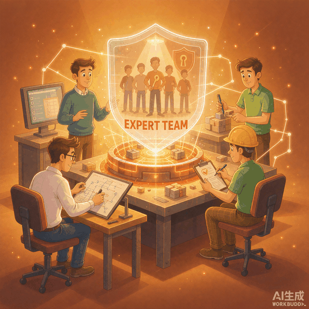

# 专家团铸造局 (Expert Team Foundry)

  

一个 WorkBuddy 专家团插件：你说清需求，它帮你**铸造一支能直接用的 AI 专家团**——拆角色、挑技能、质检、升级，全程包办。

<details>
<summary><strong>🌐 English</strong></summary>

A WorkBuddy expert-team plugin that forges a ready-to-use AI agent team from a single requirement — role scoping, skill matching, QA gating and version adjudication, all evidence-based.

- **Role scoping with hard standards** — roles are merged when possible, never split for show, and every role gets a clearly bounded responsibility.
- **Skills tested before they bind** — each candidate skill is benchmarked and verified on a real machine before it's attached to a role, so the team works out of the box.
- **No upgrade without a referee** — old and new versions are compared with quantitative scores; a regression blocks the release, no matter how it "feels".

**Install in one minute:** download the zip from [Releases](https://github.com/linwenqiang/expert-team-foundry/releases) → upload it in the WorkBuddy chat via the "+" button → send "Install" → summon it from "Experts · Skills · Connectors → Expert Teams". Alternatively, `git clone` the repo into `~/.workbuddy/plugins/marketplaces/my-experts/plugins/`.

> Full documentation is in Chinese.

</details>

<p align="center">
  
</p>

## 这是什么

想在 WorkBuddy 里搭一支 AI 专家团队，通常要自己琢磨角色怎么分、技能怎么挑、配置怎么写，做完了也没人帮你把关。装上「专家团铸造局」，你只需要说清需求，就能得到一支装好即用的专家团：怎么拆角色有硬标准，技能好不好先实测再绑定，交付前有质检，以后想升级还有专门的裁判打分裁决。

## ✨ 核心亮点

- **角色怎么拆有硬标准**：能合并就合并，不为了凑数硬拆人，每个角色都有明确的分工边界
- **技能先实测再绑定**：每个角色配什么技能都经过多方比对和真机验证，装了就能跑
- **交付留证据**：角色分工、技能选型、质检报告全部留档，不口头承诺
- **升级有裁判打分**：新旧版本量化比较，有退步就拦下，不许「感觉变强了」就通过

## 🏆 铸造案例（Real Teams Forged by This Foundry）

- **抖音评论洞察团（Douyin Comment Insight）**：采集、分析、撰稿三个角色协作，把爆款视频的评论区变成结构化舆情洞察。版本迭代前后的量化测评显示，团队能力分从 81.5 提升到 86.9。
- **商机探金团（Business Opportunity Scout）**：数据报告 → 机会清单 → 量化可行性 → 零成本落地计划，四个角色四棒接力，把一个模糊的创业想法一路打磨成可执行的生意。
- **开源渡航队（OSS Sync Crew）**：本仓库自己就是它发布的——文档、commit、tag、release 全自动流转，你只需做一次最终确认。这是最彻底的「自举」案例：铸造局铸出的团队，正在维护铸造局。

More forged teams are on the way — or forge your own（见下方安装）。

## 🚀 安装

### 方式一（推荐）· zip 安装包

1. 到 [Releases](https://github.com/linwenqiang/expert-team-foundry/releases) 下载 `expert-team-foundry-v1.6.0.zip`
2. 打开 WorkBuddy 对话框，点左下角「**+**」，上传该 zip
3. 在输入框发送「**安装**」
4. 完成后，到「**专家·技能·连接器 → 专家团**」里找到「**专家团铸造局**」即可召唤

### 方式二 · 手动放置

1. 下载 zip 并解压（或执行 `git clone https://github.com/linwenqiang/expert-team-foundry.git`）
2. 把解压出的 `expert-team-foundry` 文件夹整个放进 WorkBuddy 插件目录：

   ```
   ~/.workbuddy/plugins/marketplaces/my-experts/plugins/
   ```

   > `~` 即你的用户主目录：Windows 下是 `C:\Users\<你的用户名>`，macOS / Linux 下是 `/Users/<你的用户名>` 或 `/home/<你的用户名>`。
3. 重启 WorkBuddy

### 方式三 · 技能市场引导

如果你在 agent skills 生态中使用本仓库，可以先安装本引导技能：

```bash
npx skills add linwenqiang/expert-team-foundry
```

> 注意：这条命令安装的是**安装引导技能**，不是专家团本体。安装后按技能给出的指引（或上方方式一 / 方式二）把「专家团铸造局」装进 WorkBuddy 即可。

## 🎯 快速上手

召唤「专家团铸造局」后，直接说需求即可：

```text
帮我根据这个需求创建一个专家团：我想要一个能分析抖音评论舆情的团队
```

进阶问法：

```text
给我这个专家团的每个角色挑最合适的技能，并确认在本机真的能用
```

```text
对比这个专家团的两个版本，判断这次迭代到底有没有变强
```

## 👥 团队成员

| 名字 | 一句话职责 |
|---|---|
| 铸造总监 | 队长（专家铸造总监）。接你的需求，指挥全队干活，最后把成果汇总交给你 |
| 需求架构 | 需求架构师。把需求拆成角色分工：团队要几个人、各管什么、边界在哪 |
| 技能选型 | 技能选型师。给每个角色挑技能：多方找候选、逐个实测、打分再定 |
| 包工程 | 专家包工程师。把设计图变成真实可用的专家包，注册到你的 WorkBuddy |
| 质检合规 | 质检合规官。交付前全面体检，问题严重可一票否决 |
| 版本迭代 | 版本迭代官。裁判。给团队打分，判断一次升级该不该通过 |

## ❓ FAQ

**Q：安装后在哪里找到它？**

A：打开 WorkBuddy 左侧「**专家·技能·连接器**」→「**专家团**」，选择「专家团铸造局」即可在对话中召唤。

**Q：铸造好的专家团放在哪里？**

A：它会自动安装到你的 WorkBuddy 插件目录（`~/.workbuddy/plugins/marketplaces/my-experts/plugins/<团名>`），安装完成后同样在「专家·技能·连接器 → 专家团」里出现，可直接召唤。

**Q：有新版本了怎么升级？**

A：到 [Releases](https://github.com/linwenqiang/expert-team-foundry/releases) 下载新版 zip，按「安装」一节的步骤重新安装即可，旧版会被替换。

## 📜 版本履历

| 版本 | 日期 | 主要变更 |
|---|---|---|
| v1.6.0 | 2026-10-17 | 成员命名从花名制切换为职责词制（命名规则升级至 v2.0）；D9 评分标尺升级至 v3.1，职责词命名判定合规 |
| v1.5.0 | 2026-10-17 | 防御条款升级：新增 frontmatter 病灶检查与载体回验 |

## 📄 许可证

[MIT](LICENSE) © 2026 Lin

---

想深入了解内部质量机制（铸造流程、评分与迭代规则）？见 [docs/](docs/)。
